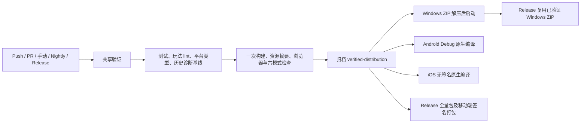

2026-11-05 故障修复与 CI 重构

本轮以审计中可复现的故障为修复范围，补足玩法源码检查及各平台构建验证。配置初始化从菜单创建中解耦：读取配置后为全部保留模式合并全局默认值、模式默认值与有效存档；首次直接进入单挑、国战、身份模式不再依赖事先打开菜单。普通数据重置兼容按大厅保存的凭据，继续保留身份；存档导入从读取文件起锁定按钮，所有返回路径均释放锁。

联机转发检查最终 JSON 信封大小，超限时关闭来源连接，不断开房主。技能请求每次接受时更新时间戳。沙盒按非调试方式创建运行域，初始化后移除 iframe，避免每个连接保留一个 DOM 运行域；重复关闭客户端成为幂等操作。浏览器回归实际运行无害远端函数、检查能力隔离，并连续创建/关闭 20 个客户端确认 iframe 数量保持稳定。

玩法目录已加入 lint，修复检查发现的常量重新赋值、重复键、case 变量作用域、不可达代码，以及随机选不到重铸牌时的错误访问。动态新增玩家的历史和统计使用独立对象，避免不同回合共享计数；距离计算的攻击修正使用独立变量。开发命令使用统一子进程编排，输出日志，并在任一服务结束时关闭其余服务。

新增命令 `pnpm test:modes` 使用临时用户目录，逐一进入六个模式，检查默认玩家数量、页面异常和进入模式后的资源预算；结果写入 `output/mode-metrics.json`。现有 `test:browser` 继续验证存档、菜单、隔离及启动恢复。模式检查覆盖初始场景及选将附近状态，不应表述为所有子模式完整对局、弱网或真机验收。

CI 拓扑如下：



`build.yml` 是 Push/PR/手动入口；`verify.yml` 是可复用验证工作流；`nightly-publish.yml` 使用同一验证链路并记录 nightly 渠道；`release.yml` 在全部验证成功后制作发布产物。删除重复的增量 lint 工作流。安装步骤统一到本地 composite action，读取 packageManager 固定 pnpm，缓存键覆盖全部 workspace 锁文件，CI 下载 Electron 使用官方镜像。Linux 固定 Ubuntu 24.04，Windows 固定 Windows 2025，iOS 使用支持 Xcode 26 的 macOS 26。

文件服务包声明必须在平台和核心类型检查前生成；核心类型检查不与清理声明的构建并行。发布和原生任务下载已验证的完整资源归档，避免在不同系统重复构建网页源码。Windows 发布复用已实际解压启动的 ZIP。Android PR 编译不需要签名密钥，正式发布仍要求仓库已有的 ANDROID_KEYSTORE_* Secrets。iOS 发布产物继续明确为 experimental 未签名 IPA。

运行方式：

```text
pnpm test
pnpm lint
pnpm lint:engineering
pnpm -F @noname/fs build
pnpm check:platforms
pnpm check:types
pnpm build
pnpm verify:assets
pnpm -F @noname/electron build
pnpm test:browser
pnpm test:modes
```

Linux 无显示环境通过 xvfb-run 执行两个浏览器命令；CI 会配置 Chromium sandbox。完整资源包需在浏览器检查前构建。Windows 最终包检查使用 `scripts/run-portable-smoke.js`，并采用独立临时存档。

本轮历史诊断基线由 21,321 降至 21,313，不扩大基线接受新错误。仍存在大量历史类型债务；巨型引擎拆分、纯数据协议迁移、字体与美术重编码属于后续结构性工作，未以一次机械改写替代行为验证。Android/iOS 真机安装、系统分享、长局和公网容量需要实际设备与部署环境。

上次公开 Build 记录为 https://github.com/tst936137555/noname/actions/runs/42027070959 ，状态失败。当前 GitHub CLI 未登录，匿名 API 达到限额，网页日志要求登录；因此没有将无法读取的具体失败步骤冒称为已确定根因。本轮通过本地检查与工作流静态验证确认修改，远端运行结果应在提交后的新 CI 记录中验收。
